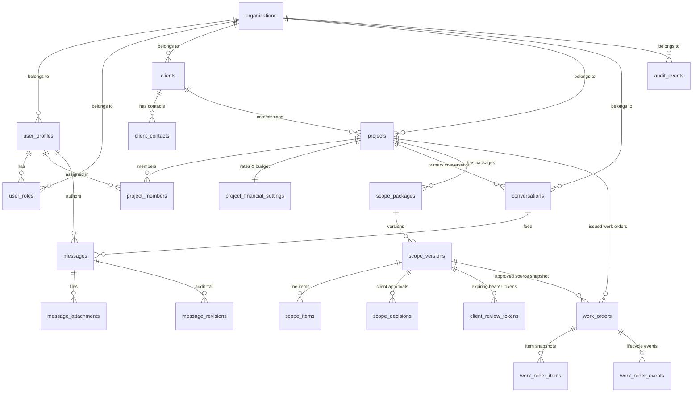

# Entity-Relationship Diagram & Schema Architecture

## Database Architecture Overview
The Accelvia Work Management System is anchored on PostgreSQL as the single source of truth. All relations enforce organization scoping, foreign key integrity, append-only audit triggers, and row-level security (RLS).

---

## Core Domain Tables

### 1. `organizations`
- `id` (UUID, PK)
- `name` (TEXT)
- `default_timezone` (TEXT, default `'Asia/Dhaka'`)
- `created_at` (TIMESTAMPTZ, immutable)
- `updated_at` (TIMESTAMPTZ)

### 2. `user_profiles` & `user_roles`
- `user_profiles.user_id` (UUID, PK -> auth.users)
- `user_profiles.organization_id` (UUID -> organizations)
- `user_profiles.display_name` (TEXT)
- `user_profiles.account_status` (ENUM: `active`, `invited`, `suspended`, `deactivated`)
- `user_roles.role` (ENUM: `super_admin`, `admin`, `member`)
- *Security Rule:* Super Admin profile is excluded from queries by non-Super-Admin roles.

### 3. `clients` & `client_contacts`
- `clients.id` (UUID, PK)
- `clients.name` (TEXT)
- `clients.default_timezone` (TEXT, IANA e.g. `'America/New_York'`)
- `clients.notes_internal` (TEXT, confidential)
- `client_contacts.email` (TEXT)

### 4. `projects` & `project_members`
- `projects.id` (UUID, PK)
- `projects.client_id` (UUID -> clients)
- `projects.timezone` (TEXT, IANA e.g. `'America/New_York'`)
- `project_members.user_id` (UUID -> user_profiles)
- `project_members.assignment_role` (TEXT)
- *Security Rule:* Members can only select projects they are explicitly assigned to.

### 5. `project_financial_settings`
- `project_id` (UUID, PK -> projects)
- `internal_budget_hours` (NUMERIC)
- `client_rate_usd_per_hour` (NUMERIC)
- `client_rate_bdt_per_hour` (NUMERIC)
- `internal_budget_amount_usd` (NUMERIC)
- `internal_budget_amount_bdt` (NUMERIC)
- *Security Rule:* STRICTLY RESTRICTED to `admin` and `super_admin`. Denied to `member`.

### 6. `conversations`, `messages`, `message_attachments`
- `messages.id` (UUID, PK)
- `messages.conversation_id` (UUID -> conversations)
- `messages.author_user_id` (UUID)
- `messages.content_json` (JSONB)
- `messages.event_at` (TIMESTAMPTZ, editable by Super Admin with audit)
- `messages.deleted_at` (TIMESTAMPTZ, soft-deletion)
- *Security Rule:* RPC `get_conversation_messages_safe` masks Super Admin authors as `Management` for Admins and Members.

### 7. `scope_packages`, `scope_versions`, `scope_items`
- `scope_packages.package_kind` (ENUM: `initial`, `additional`)
- `scope_versions.version_number` (INT)
- `scope_versions.status` (ENUM: `draft`, `pending`, `revision_requested`, `approved`, `rejected`, `superseded`, `void`)
- `scope_versions.total_hours_snapshot` (NUMERIC)
- `scope_versions.total_usd_snapshot` (NUMERIC, hidden from Members)
- `scope_versions.total_bdt_snapshot` (NUMERIC, hidden from Members)
- `scope_items.hours` (NUMERIC, visible to assigned Members)

### 8. `client_review_tokens` & `scope_decisions`
- `client_review_tokens.token_hash` (TEXT, SHA-256 hash of random 256-bit token)
- `client_review_tokens.expires_at` (TIMESTAMPTZ)
- `client_review_tokens.revoked_at` (TIMESTAMPTZ)
- `scope_decisions.decision` (ENUM: `approved`, `rejected`, `revision_requested`)
- `scope_decisions.decision_source` (ENUM: `client_review_link`, `admin_recorded_client_response`, `super_admin_override`)

### 9. `work_orders` & `work_order_items`
- `work_orders.work_order_number` (TEXT, unique e.g. `WO-20261030-0001`)
- `work_orders.approved_scope_version_id` (UUID -> scope_versions, MUST be `status = 'approved'`)
- `work_orders.work_order_kind` (ENUM: `detailed`, `summary`)
- `work_orders.status` (ENUM: `approved`, `in_progress`, `delivered`, `completed`, `cancelled`)
- `work_orders.hours_snapshot` (NUMERIC)
- `work_orders.total_usd_snapshot` (NUMERIC, hidden from Members)

### 10. `audit_events`
- `id` (UUID, PK)
- `entity_type` (TEXT)
- `entity_id` (UUID)
- `action` (TEXT)
- `before_state` (JSONB)
- `after_state` (JSONB)
- `reason` (TEXT)
- `server_recorded_at` (TIMESTAMPTZ, immutable)
- *Security Rule:* Append-only; `UPDATE` and `DELETE` revoked from all application users. Read access granted ONLY to `super_admin`.
